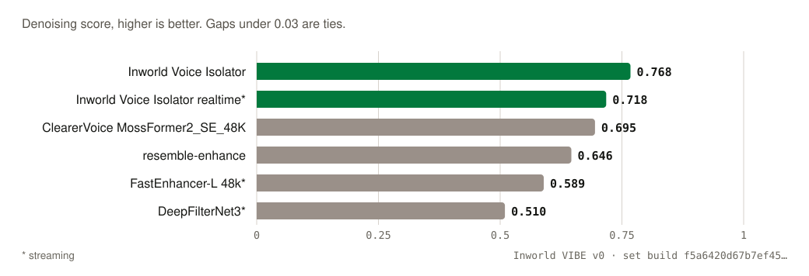
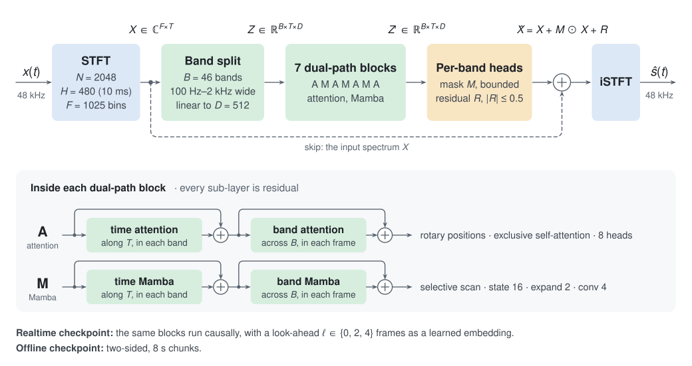

<p align="center">
  <picture>
    <source media="(prefers-color-scheme: dark)" srcset="docs/assets/inworld-logo-white.svg">
    
  </picture>
</p>

<h1 align="center">Voice Isolator</h1>

<p align="center">
  Open-license (Apache-2.0) 48 kHz voice isolation for noisy speech recordings and live audio.
</p>

<p align="center">
  <a href="https://github.com/inworld-ai/voice-isolator"></a>
</p>

---

## TL;DR

Inworld Voice Isolator v1 ships as two models that share one architecture:

| | `voice-isolator-v1` | `voice-isolator-v1-realtime` |
|---|---|---|
| made for | recorded audio and anything not latency-sensitive, at the best quality | live audio, as a stream in your pipeline or production |
| how it runs | offline: every frame sees its whole 8 s chunk | a causal stream with 20 ms of look-ahead |
| parameters | 64M | 58M |

**Use them for** cleaning recordings before playback or publication, curating speech datasets and voice pipelines where the speaker's identity must survive.
With the realtime model, use them for live calls and streams.
Subtract the isolated voice from the input to extract background noise or a backing-track residual for vocals/music separation.

**They are not** a speaker selector or a restoration model.
Restoration is planned for version 2 (see [Plans](https://github.com/inworld-ai/voice-isolator#plans)).

## Quick start

Using a coding agent? Point it at the [setup section of AGENTS.md](https://github.com/inworld-ai/voice-isolator/blob/main/AGENTS.md#setting-up-the-voice-isolator-for-a-user): it installs the package, checks the machine with `voice-isolate-doctor` and cleans a first file.

```bash
pip install inworld-voice-isolation
# or from a clone: git clone https://github.com/inworld-ai/voice-isolator && cd voice-isolator && pip install -e .

# a noisy example; a clone also has it at demo/examples/sample_14.wav
curl -LO https://raw.githubusercontent.com/inworld-ai/voice-isolator/main/demo/examples/sample_14.wav

# offline isolation (downloads the offline model on first use):
# the voice goes to sample_14_clean.wav and the removed background
# to sample_14_clean_background.wav, beside it
voice-isolate sample_14.wav sample_14_clean.wav
```

Both are float32 WAVs at 48 kHz, with their original levels preserved; together they reconstruct the aligned mono input.
Use `--output-sr 0` to keep the input rate, `--background noise.wav` to choose the background path for one file, or `--no-background` to save only the voice.

```python
from inworld import voice_isolation

# isolate a recording offline
offline = voice_isolation.VoiceIsolator("inworld/voice-isolator")
wav, sample_rate = voice_isolation.load_audio("sample_14.wav")
voice = offline.isolate(wav, sample_rate)
voice_isolation.save_audio("sample_14_clean.wav", voice, sample_rate, subtype="FLOAT")
voice_isolation.save_audio("sample_14_clean_background.wav", wav - voice, sample_rate, subtype="FLOAT")  # what was removed
```

### Streaming

The realtime model isolates the voice as the audio arrives, with 20 ms of look-ahead:

```python
import torch
from inworld import voice_isolation

live = voice_isolation.VoiceIsolator("inworld/voice-isolator",
                                     mode="streaming", lookahead_frames=2)
session = live.stream()                             # takes 48 kHz mono, in pieces of any size
wav, sample_rate = voice_isolation.load_audio("sample_14.wav")  # 48 kHz mono, standing in for a live source
voice = []
for start in range(0, len(wav), 960):               # 20 ms at a time, as a microphone delivers it
    voice.append(session.push(wav[start:start + 960]))  # the samples that are final: play or send them
voice.append(session.flush())                       # the rest, once the source ends
voice_isolation.save_audio("sample_14_streamed.wav", torch.cat(voice), sample_rate)
```

The streaming CLI writes only the isolated voice, after the whole file has gone through:

```bash
voice-isolate sample_14.wav sample_14_streamed.wav --mode streaming --lookahead 2
```

The weights download on first use, and their checksums are verified.
The mode picks the checkpoint: `voice-isolator-v1` offline, `voice-isolator-v1-realtime` for streaming.
CUDA is used when available, Apple's Metal backend (`mps`) on an Apple-silicon Mac with PyTorch 2.6 or later, and the CPU otherwise; `--device` picks one.

The code, the [interactive demo](https://github.com/inworld-ai/voice-isolator/blob/main/demo/README.md) and the [benchmark](https://github.com/inworld-ai/voice-isolator/blob/main/bench/README.md) are on GitHub: [inworld-ai/voice-isolator](https://github.com/inworld-ai/voice-isolator).
The demo loads both models at startup: **Offline** processes files and samples into voice and background audio; **Online** streams the microphone for up to 60 seconds with updating waveforms and spectrograms, pausing capture before playback.

## Hardware

Tested on NVIDIA Ampere, Hopper and Blackwell GPUs (A100, H100, B200 and B300) and on CPU.
Smaller GPUs are not tested yet (see [Plans](https://github.com/inworld-ai/voice-isolator#plans)).

## The VIBE benchmark

<p align="center">
  <picture>
    <source media="(prefers-color-scheme: dark)" srcset="docs/assets/board-dark.svg">
    
  </picture>
</p>

Inworld VIBE (Voice Isolation Benchmark and Evals) ranks 48 kHz voice isolators on two boards.
The chart is the denoising board, which ranks every system except those that put more than 10 dB more energy above a band-limited input's band than inside it; those are ranked on restoration.
Inworld scores every system on its internal evaluation set, which is not distributed.

[How the systems are scored and what the scores mean](https://github.com/inworld-ai/voice-isolator/blob/main/bench/README.md).

## Architecture

<p align="center">
  <picture>
    <source media="(prefers-color-scheme: dark)" srcset="docs/assets/architecture-dark.svg">
    
  </picture>
</p>

A band-split dual-path network over the STFT (n_fft 2048, hop 480 at 48 kHz, 10 ms frames).
Each frame's spectrum is cut into 46 bands, narrow at low frequency and wide at the top, one token per band and frame, width 512.
Seven blocks refine the tokens, alternating two kinds.
Four blocks run time attention with rotary position and exclusive self attention, followed by attention across bands.
Three blocks run Mamba along time, followed by Mamba across bands (state 16).
Per-band heads produce a bounded complex mask and a bounded per-bin residual, added to the input spectrum.
The offline model has 64.0M parameters.
The realtime model has 58.2M; its blocks are causal and it carries a look-ahead embedding.
Input is one channel at 48 kHz; nothing is separated or synthesized beforehand.

## Two checkpoints

The offline model, `voice-isolator-v1`, is two-sided: every frame sees its whole 8 s chunk, and long inputs render in 8 s chunks overlapping by 2 s.
The realtime model, `voice-isolator-v1-realtime`, is causal, with a trained look-ahead of 0, 20 or 40 ms; its algorithmic latency is 63 ms at 20 ms of look-ahead.
Both keep the foreground voice: when two people speak at once, the louder voice is kept and one a few dB quieter is removed, while voices at similar levels are usually both kept.
In the speech-enhancement literature, version 1 does denoising (noise suppression): it removes what surrounds the voice and restores nothing the recording lost, such as missing bandwidth; restoration comes with version 2.

## Training data

Inworld Voice Isolator v1 was trained on approximately 10,000 hours of unique audio.
Paired examples built from recorded speech: read and conversational speech in many languages, expressive and character voices, whispered speech, singing, and the speaker's own non-verbal sounds such as laughter, breaths and sighs.
The speech was mixed with environmental and household noise, traffic, rain and wind, music and crowd sound, isolated transient events and competing talkers, through measured and simulated room responses and telephony and codec degradations.
Real recordings of the same speech, captured clean and in rooms, complete the set.
The objective: return the voice as it was recorded, remove everything that is not the speaker (noise, music, other voices and the late room tail), keep the speaker's own non-verbal sounds, level and timing, and invent nothing.

Third-party datasets used in training are credited in [NOTICE](NOTICE).

## License

Code and weights are Apache-2.0 ([LICENSE](LICENSE)).
Third-party notices are in [NOTICE](NOTICE).

## How to contribute

Everyone is welcome to use the model however they like and to make it better in any way they see fit!
Development happens on GitHub: see [CONTRIBUTING.md](https://github.com/inworld-ai/voice-isolator/blob/main/CONTRIBUTING.md) for setup, tests and bug reports.

---

<p align="center">Built for people with ❤️ by Inworld.</p>
