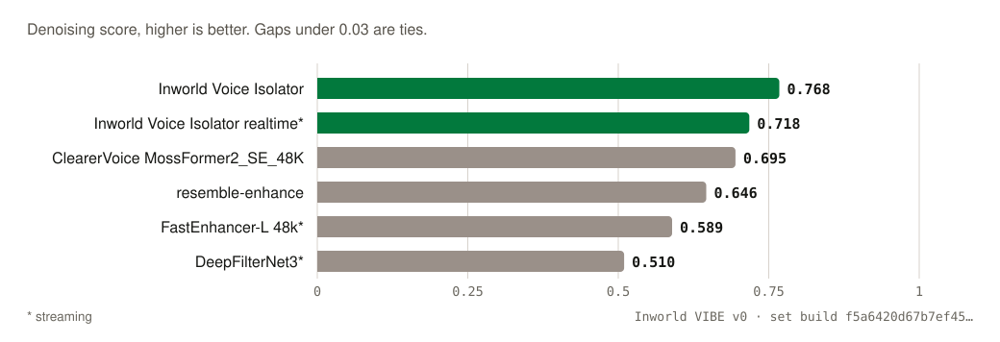
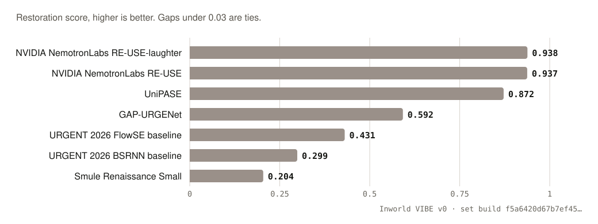
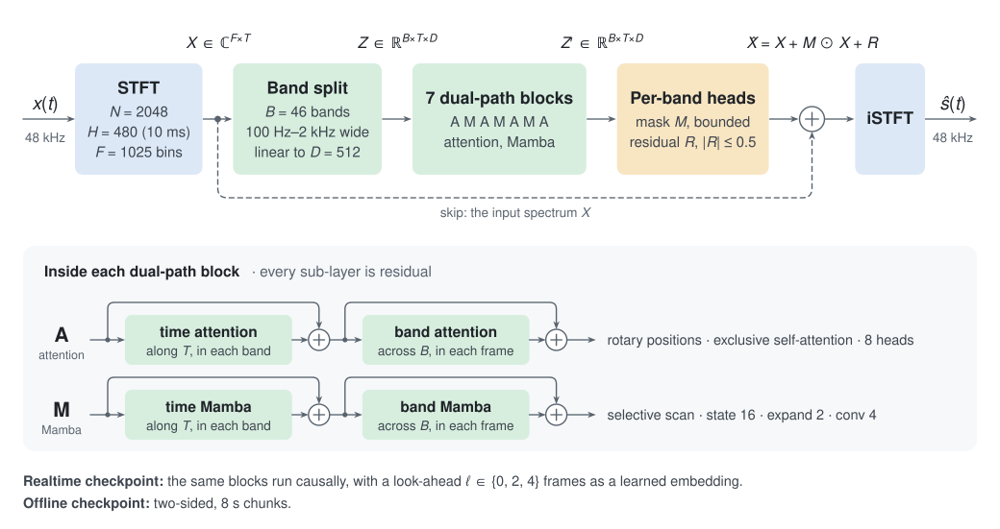

<p align="center">
  <picture>
    <source media="(prefers-color-scheme: dark)" srcset="docs/assets/inworld-logo-white.svg">
    
  </picture>
</p>

<h1 align="center">Voice Isolator</h1>

<p align="center">
  Open-license (Apache-2.0) 48 kHz voice isolation for noisy speech recordings and live audio.
</p>

<p align="center">
  <a href="https://huggingface.co/inworld/voice-isolator"></a>
</p>

---

## TL;DR

Inworld Voice Isolator v1 ships as two models that share one architecture:

| | `voice-isolator-v1` | `voice-isolator-v1-realtime` |
|---|---|---|
| made for | recorded audio and anything not latency-sensitive, at the best quality | live audio, as a stream in your pipeline or production |
| how it runs | offline: every frame sees its whole 8 s chunk | a causal stream with 20 ms of look-ahead |
| parameters | 64M | 58M |

**Use them for** cleaning recordings before playback or publication, curating speech datasets and voice pipelines where the speaker's identity must survive.
With the realtime model, use them for live calls and streams.
Subtract the isolated voice from the input to extract background noise or a backing-track residual for vocals/music separation.

**They are not** a speaker selector or a restoration model.
Restoration is planned for version 2 (see [Plans](#plans)), stay tuned!

## Quick start

Using a coding agent? Point it at the [setup section of AGENTS.md](https://github.com/inworld-ai/voice-isolator/blob/main/AGENTS.md#setting-up-the-voice-isolator-for-a-user): it installs the package, checks the machine with `voice-isolate-doctor` and cleans a first file.

```bash
pip install inworld-voice-isolation
# or from a clone: git clone https://github.com/inworld-ai/voice-isolator && cd voice-isolator && pip install -e .

# a noisy example; a clone also has it at demo/examples/sample_14.wav
curl -LO https://raw.githubusercontent.com/inworld-ai/voice-isolator/main/demo/examples/sample_14.wav

# offline isolation (downloads the offline model on first use):
# the voice goes to sample_14_clean.wav and the removed background
# to sample_14_clean_background.wav, beside it
voice-isolate sample_14.wav sample_14_clean.wav
```

Both are float32 WAVs at 48 kHz, with their original levels preserved; together they reconstruct the aligned mono input.
Use `--output-sr 0` to keep the input rate, `--background noise.wav` to choose the background path for one file, or `--no-background` to save only the voice.

```python
from inworld import voice_isolation

# isolate a recording offline
offline = voice_isolation.VoiceIsolator("inworld/voice-isolator")
wav, sample_rate = voice_isolation.load_audio("sample_14.wav")
voice = offline.isolate(wav, sample_rate)
voice_isolation.save_audio("sample_14_clean.wav", voice, sample_rate, subtype="FLOAT")
voice_isolation.save_audio("sample_14_clean_background.wav", wav - voice, sample_rate, subtype="FLOAT")  # what was removed
```

### Streaming

The realtime model isolates the voice as the audio arrives, with 20 ms of look-ahead:

```python
import torch
from inworld import voice_isolation

live = voice_isolation.VoiceIsolator("inworld/voice-isolator",
                                     mode="streaming", lookahead_frames=2)
session = live.stream()                             # takes 48 kHz mono, in pieces of any size
wav, sample_rate = voice_isolation.load_audio("sample_14.wav")  # 48 kHz mono, standing in for a live source
voice = []
for start in range(0, len(wav), 960):               # 20 ms at a time, as a microphone delivers it
    voice.append(session.push(wav[start:start + 960]))  # the samples that are final: play or send them
voice.append(session.flush())                       # the rest, once the source ends
voice_isolation.save_audio("sample_14_streamed.wav", torch.cat(voice), sample_rate)
```

The streaming CLI writes only the isolated voice, after the whole file has gone through:

```bash
voice-isolate sample_14.wav sample_14_streamed.wav --mode streaming --lookahead 2
```

`inworld/voice-isolator` is the weights' repository, [huggingface.co/inworld/voice-isolator](https://huggingface.co/inworld/voice-isolator): they download on first use and are checked against the checksums in [the registry](https://github.com/inworld-ai/voice-isolator/blob/main/src/inworld/voice_isolation/registry.py).
The mode picks the checkpoint: `voice-isolator-v1` offline, `voice-isolator-v1-realtime` for streaming.
`--model` and `VoiceIsolator(...)` also take either name, a local checkpoint path or an `hf://<org>/<repo>/<file>[@<revision>]` location.
Python 3.10 or later and PyTorch 2.1 or later; `pip install "inworld-voice-isolation[fast]"` adds the CUDA Mamba kernels.
CUDA is used when available, Apple's Metal backend (`mps`) on an Apple-silicon Mac with PyTorch 2.6 or later, and the CPU otherwise; `--device` picks one.

The [interactive demo](https://github.com/inworld-ai/voice-isolator/blob/main/demo/README.md) has **Offline** and **Online** tabs, with both models loaded at startup.
Offline processes files and samples into voice and background audio. Online streams the microphone for up to 60 seconds, updating waveforms and spectrograms as you speak; capture pauses before playback.
The background is whatever the model removed and can contain voice leakage.

The [audio cleanup notebook](https://github.com/inworld-ai/voice-isolator/blob/main/examples/audio_cleanup.ipynb) walks through a first evaluation: clean a noisy sample, compare it with the original by ear, then try your own recording.

## Hardware

Tested on NVIDIA Ampere, Hopper and Blackwell GPUs (A100, H100, B200 and B300) and on CPU.
Smaller GPUs are not tested yet (see [Plans](#plans)).

## The VIBE benchmark

<p align="center">
  <picture>
    <source media="(prefers-color-scheme: dark)" srcset="docs/assets/board-dark.svg">
    
  </picture>
</p>
<p align="center">
  <picture>
    <source media="(prefers-color-scheme: dark)" srcset="docs/assets/board-restoration-dark.svg">
    
  </picture>
</p>

Inworld VIBE (Voice Isolation Benchmark and Evals) ranks 48 kHz voice isolators on two boards.
A system that puts more than 10 dB more energy above a band-limited input's band than inside it is ranked on restoration; every other system is ranked on denoising.
Inworld scores every system on its internal evaluation set, which is not distributed.

[How the systems are scored and what the scores mean](https://github.com/inworld-ai/voice-isolator/blob/main/bench/README.md).

## Architecture

<p align="center">
  <picture>
    <source media="(prefers-color-scheme: dark)" srcset="docs/assets/architecture-dark.svg">
    
  </picture>
</p>

See the model card for [architecture details](https://github.com/inworld-ai/voice-isolator/blob/main/MODEL_CARD.md#architecture) and [training data](https://github.com/inworld-ai/voice-isolator/blob/main/MODEL_CARD.md#training-data).

## Plans

- [x] Version 1, denoising only: two checkpoints, one for recordings and one for live audio.
- [ ] Version 2: one model that runs offline or streaming and does denoising and restoration.
      It keeps removing what is around the voice, and restores what the recording lost when asked to.
      It will be scored on both VIBE boards.
- [ ] Testing on smaller GPUs.
- [ ] On-device support (beyond Apple silicon).
- [ ] Allow natural language prompting.

## License

Code and weights are Apache-2.0 ([LICENSE](https://github.com/inworld-ai/voice-isolator/blob/main/LICENSE)).
Third-party notices are in [NOTICE](https://github.com/inworld-ai/voice-isolator/blob/main/NOTICE).

## How to contribute

Everyone is welcome to use the model however they like and to make it better in any way they see fit!
Ask your agent to open a PR and we'll take a look.
See [CONTRIBUTING.md](https://github.com/inworld-ai/voice-isolator/blob/main/CONTRIBUTING.md) for setup, tests and bug reports, and [AGENTS.md](https://github.com/inworld-ai/voice-isolator/blob/main/AGENTS.md) for coding conventions.

---

<p align="center">Built for people with ❤️ by Inworld.</p>
