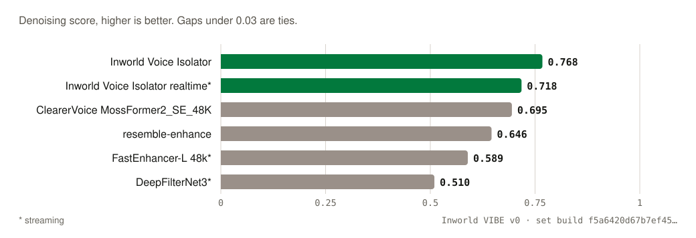
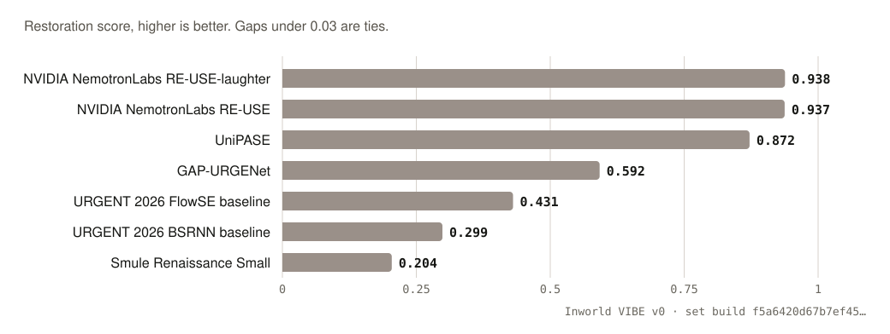

# Inworld VIBE: Voice Isolation Benchmark and Evals

VIBE measures how well a system takes one voice out of a noisy recording.
It ranks systems on two boards:

- **Denoising**: remove everything that is not the voice, and keep the voice exactly as it was recorded.
- **Restoration**: give back the dry voice of a speaker recorded in a reverberant room.

Everything is scored at 48 kHz over the full band, with one implementation of every metric for every system, on recordings screened against our model's training data by recording; a few items share a speaker with it ([The eval set](#the-eval-set)).

Read the boards with three facts in mind:

- Inworld maintains both the benchmark and one of the models on it, and chose that model's checkpoints with these scores in view. The other systems run from their upstream releases and were not tuned on the benchmark.
- Inworld scores every system itself, on an internal evaluation set that is not distributed.
- The two scores measure the two tasks declared here, not speech enhancement in general.

## Leaderboard

  <picture>
    <source media="(prefers-color-scheme: dark)" srcset="../docs/assets/board-dark.svg">
    
  </picture>

  <picture>
    <source media="(prefers-color-scheme: dark)" srcset="../docs/assets/board-restoration-dark.svg">
    
  </picture>

- `*` marks a streaming system: it looks at most 100 ms ahead and holds its quality through a long recording, within 1 dB of the same stretch started fresh ([streaming probe](METRICS.md#streaming-probe)).
- The charts show the full-band tier: systems that run at 48 kHz or 44.1 kHz. A 16 kHz tier, scored inside 0–8 kHz and not comparable with these charts, has no entrant on this build of the set.
- The unprocessed input and Demucs vocals (a music-separation reference) are scored as reference rows and not ranked.
- The charts come from Inworld's score files on build `f5a6420d67b7ef45…` of the set, ranked by `scripts/leaderboard.py`.

## What the scores mean

A system that adds sound above the band of a band-limited input (more than 10 dB more energy above that band than inside it) is ranked on restoration; every other system is ranked on denoising.
Every system is scored on both.

The scores are built from ten axes in four parts:

| Part | Axis | What it checks |
|---|---|---|
| Removes | suppression (`supp`) | crowd chatter, and ambience, steady noise and traffic louder than the voice |
| | `music` | an instrumental music bed louder than the voice |
| | `cleanup` | what is left in the pauses of real recordings, and the noise floor of the voice's own room |
| | `events` | sudden sounds in the voice's own room, in the pauses and under the speech |
| | `voices` | a competing talker 5 dB under the speaker |
| Keeps | preservation (`pres`) | the voice kept whole: no speech deleted from real recordings, quiet speech kept under chatter, laughs and breaths kept under noise, the voice's level held |
| | fidelity (`fidel`) | clean speech left alone: its quiet parts, level, high band, speaker, quality, spectrum, laughs and breaths |
| Sounds | `timbre` | the speaker still sounds like themselves, over twelve kinds of noise |
| | quality (`qual`) | predicted listening quality (NISQA), under chatter and on real recordings |
| Restores | `room` | the dry voice out of speech recorded in real rooms |

- Denoising is the average of the first three parts. Restoration is the fourth part alone.
- Each axis is the average of its rows and each part the average of its axes, so an axis added on one side takes no weight from another.
- Every measurement sits on a 0–1 scale with fixed ends: 0 is the unprocessed input or a declared constant, 1 is the clean reference or a declared constant ([anchors.json](anchors.json), [PROTOCOL.md](PROTOCOL.md)). The ends belong to the set, not to the other systems, so adding or removing a system never moves another system's score.
- Gaps under 0.03 on either score are ties, and so are timbre gaps under 0.05. These are reporting rules, not statistical confidence intervals.
- A system that leaves the room as recorded scores zero on `room`, because that task asks for the dry voice.
- A system that keeps every voice scores near zero on `voices`, because these boards count a competing talker as noise.
- `band`, the sound a system adds above a band-limited input's band, is shown beside both scores and counts in neither: it measures added energy, not restored speech, and a tone added there would score on it.

[METRICS.md](METRICS.md) defines every metric and shows the other views: the multilingual core, real rooms, the streaming probe, how much of the order is policy, and downstream speech recognition.

### Task contracts

Each condition of the set asks one of three things, and a score is only meaningful under the contract it was measured against ([`scripts/contracts.py`](scripts/contracts.py) states them, [METRICS.md](METRICS.md#task-contracts) gives the full rules):

- **Denoise**, every condition not named below: keep the voice as it was recorded, at its level, in its band and in its own room, with its laughs, breaths and sighs. Remove everything else, including a competing talker and noise in the voice's own room. On the band-limited rows (`srsweep_*`), the band the input lacks is not the system's to invent.
- **Voice policy** (`singer`, `conversation`, `long`, `music_vocal`): which voices are content. A singer who is the target stays, a song's own singer behind speech goes, and both sides of a conversation stay. These rows are shown beside the boards, not in them: a system that keeps only one speaker removes the other voices by design, which is not a failure.
- **Restoration** (`reverb_real`, `reverb_synth`): the reference is the dry voice, better than the voice in the input. `reverb_real` is the room axis, the restoration score; `reverb_synth` is a diagnostic.

## The eval set

- 5,502 items over 77 conditions: 4,898 paired items in 13 languages, 96 noise beds with no speech at all, and 508 real recordings in 128 languages.
- Most items are one whole utterance that ends naturally, three to twenty seconds long with room around it; the long items run 45 seconds.
- A paired item comes with a clean full-band reference: speech at a normal level, well above its own noise floor. The mix and the reference share one gain, so the SNR label is exact.
- 36 items are of speakers who have, or may have, other recordings in the Inworld model's training data.
- Every build of the set has an id computed over its files and labels, so a changed crop or label makes a different set. The boards are scored on build `f5a6420d67b7ef45…`, and `scripts/validateset.py --full` re-checks a build.

[METRICS.md](METRICS.md#the-conditions) lists the conditions, what each one catches, and the multilingual core.

## How the numbers are produced

Inworld renders and scores every system, its own included, with the scripts in this directory.
Each external system runs from its upstream release at a pinned revision, in its own environment (`scripts/setupfield.sh`, `scripts/runfield.sh`), and `wrappers/meta/<system>.json` says how it was run.
Every score file records the build of the set it was scored on, and the leaderboard refuses to rank results from different builds.
`scripts/leaderboard.py --results <results>` prints both boards with every axis from a directory of score files.

This directory holds the method, not the data: every scorer, the anchors ([anchors.json](anchors.json)), the axes ([axes.json](axes.json)) and each system's wrapper.
The eval set and the score files are not distributed, so the boards cannot be recomputed outside Inworld.
How a score is tied to the exact audio it rated, and what each metric can and cannot see, is in [METRICS.md](METRICS.md#how-a-score-is-bound-to-what-was-rendered).

## Adding a system

Write a wrapper that follows [WRAPPER_CONTRACT.md](WRAPPER_CONTRACT.md) and open a pull request with it; Inworld renders and scores it.

## Licenses of the systems compared

As each system's description states them (`wrappers/meta/<system>.json`); check upstream before building on any of them.

| System | License |
|---|---|
| ClearerVoice-Studio | Apache-2.0 code and weights |
| DeepFilterNet3 | MIT or Apache-2.0 |
| FastEnhancer-L | MIT |
| GAP-URGENet | MIT code, Apache-2.0 weights |
| UniPASE | MIT code, Apache-2.0 weights |
| Smule Renaissance Small | MIT code and weights |
| NVIDIA NemotronLabs RE-USE and RE-USE-laughter | OpenMDW-1.1 code and weights |
| URGENT 2026 baselines | Apache-2.0 code; checkpoints from the organizers' release, which states no license |
| resemble-enhance | MIT code; weights without a stated license |
| Demucs (the reference row) | MIT |

Nothing third-party is redistributed here: `scripts/setupfield.sh` fetches each system from its source at a pinned revision.
